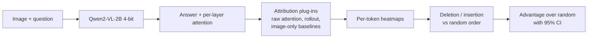

# VeriTrace AI

**Auditing *why* a vision-language model answers the way it does, and testing whether that explanation deserves trust.**

<!-- After you push, add this badge (replace YOUR_USERNAME) once veritrace_colab.ipynb is in the repo root:
[](https://colab.research.google.com/github/YOUR_USERNAME/veritrace-ai/blob/main/veritrace_colab.ipynb)
-->

Given an image and a question, VeriTrace runs Qwen2-VL-2B (4-bit, fits on a 4 GB GPU), turns the model's attention into per-token heatmaps with several attribution methods, and **scores each heatmap with deletion/insertion tests against random and image-only baselines**. The goal is not just to draw heatmaps, but to measure whether they carry information.

> **Status: research prototype.** Single-image results below are preliminary. The batch evaluation section is marked TODO until it has been run.

---

## Key findings

**1. Attention rollout collapses on this model, and the mechanism is measurable.**
Rollout multiplies attention matrices layer by layer, so it behaves like a Markov chain. In a causal model, token 0 can only attend to itself, which makes it an absorbing "drain". Measured on one example (answer rows, averaged):

| method | first token | image | other prompt | answer tokens |
|---|---|---|---|---|
| raw_attention | 0.416 | 0.196 | 0.218 | 0.170 |
| rollout | **1.000** | **0.000** | 0.000 | 0.000 |
| rollout_nosink (token 0 removed) | 0.000 | 0.004 | **0.996** | 0.000 |

Removing token 0 only moves the drain to the next-earliest prompt tokens, as predicted by a synthetic test before the real run. Both rollout variants score no better than random order on deletion.

**2. Raw attention shows a modest signal on deletion, none on insertion (one image, one token).**

| method | deletion AUC (lower is better) | insertion AUC (higher is better) |
|---|---|---|
| raw_attention | **0.66** | 0.77 |
| rollout | 0.79 | 0.79 |
| rollout_nosink | 0.78 | 0.76 |
| random order | 0.77 ± 0.03 | 0.76 ± 0.04 |

Caveat: this may reflect "finds the object" rather than "finds the evidence". Image-only baselines (center bias, edge contrast, colour distinctness) exist to test exactly that.

**3. Batch result over N images: TODO.**

<!-- TODO after running evaluate.py + summarize.py: paste the summary table and add results/advantage.png.
Report: number of usable samples (and how many were skipped and why), mean advantage over random with 95% CI,
and win rate, for raw_attention, rollout, and the three baselines. State plainly whether raw attention
beats the baselines. -->

---

## Figures


*Heatmaps for the answer token ` red`. Titles show normalised entropy (H) and image mass (img), the share of attention that reached the image before renormalisation. `img=0.00` means the map is built from almost nothing.*


*Deletion (hide top-ranked patches) and insertion (reveal them). The dashed line is the average of random patch orders, with ±1 std shaded.*

---

## How it works



- **One forward pass, shared.** The model runs once; attention is captured by re-feeding prompt + answer (teacher forcing). Causal masking makes this identical to the attention seen during generation.
- **From matrix to heatmap.** Take the rows that *decided* each answer token (row `P-1+k` decides token `k`), keep the image-token columns, record the mass, renormalise to sum to 1, reshape to the patch grid.
- **Plug-in methods.** Each method implements `explain(run) -> Explanation` and registers by name. The attribution layer is plain numpy, so it is unit-tested without a GPU.
- **Image mass is tracked.** Renormalising hides how little attention may have reached the image, so the raw mass is stored next to every map.

## Evaluation protocol

- **Target:** the first content word of a short answer ("red", "dog", "yes").
- **Deletion / insertion:** grey out (or reveal) the top-k patches for k = 0..100%; measure the probability of the original answer token; score by area under the curve.
- **Random baseline:** average over shuffled patch orders, per sample. Methods are compared by *paired advantage over that sample's own random baseline*.
- **Controls:** `center_bias`, `edge_contrast`, `color_distinct` never look at the model; `rollout` is a known-collapsed control.
- **Filters:** samples are skipped (and counted) if the model is unsure (P < 0.5) or answers well from a blank image (P(clean) − P(blank) < 0.3).
- **Statistics:** 95% bootstrap confidence intervals of the mean advantage, plus win rate. A method is distinguishable from random only if its interval excludes 0.

## Quickstart

**Colab (recommended).** Open `veritrace_colab.ipynb`, choose a T4 GPU, run top to bottom. Part A explains one image; Part B runs the batch evaluation (resumable).

**Local.**
```bash
pip install -r requirements.txt
python -m pytest -q tests                      # 29 tests, no GPU needed
python run_demo.py --image photo.jpg --question "What color is the car?" --word red --faithfulness
python evaluate.py --images images --max_samples 80    # writes results.jsonl, resumable
python summarize.py results.jsonl                      # table + advantage.png
```
Use Python 3.10–3.12 locally. On Python 3.14 we hit a native crash while loading weights (see Limitations).

## Project structure

```
veritrace/
  core.py                 ModelRun, Explanation (plain numpy containers)
  models/qwen2vl.py       the only torch/transformers file; 4-bit load, attention capture, token scoring
  attribution/            base.py, registry.py, attention.py, rollout.py, baselines.py, diagnostics.py
  metrics/                faithfulness.py (deletion/insertion), aggregate.py (statistics)
  viz/                    overlay.py, curves.py, advantage.py
run_demo.py               one image: heatmaps + optional faithfulness
evaluate.py, summarize.py batch evaluation and statistics
tests/                    29 tests on synthetic data
```

**Add a method:** create a class that subclasses `AttributionMethod` (or `MatrixAttribution`), decorate it with `@register("my_method")`, and add one import line in `veritrace/attribution/__init__.py`.

## Limitations

- One model (Qwen2-VL-2B, 4-bit). Findings may not transfer to other architectures or sizes.
- Attention is not a causal explanation; the deletion/insertion tests are the evidence, not the heatmaps.
- Deletion/insertion use flat grey patches, which are out-of-distribution for the model, and the patch grid is coarse. The random baseline controls for this but does not remove it.
- Insertion showed no separation between methods in the single-image run, and the model is highly redundant on simple colour questions.
- Attention entropy and image mass are computed, but **no hallucination detector has been validated**.
- The sanity check from Adebayo et al. (randomising model weights), noise sensitivity, and saliency consistency are not implemented yet.
- Local Windows run on Python 3.14 crashed with an access violation while loading weights (inside `transformers`/`torch` storage reads); all reported runs used Google Colab.

## Roadmap

- [ ] Model-randomisation sanity check (Adebayo et al.)
- [ ] Batch evaluation over 50+ images with CIs (results above)
- [ ] Gradient-weighted attention and/or Integrated Gradients as additional methods
- [ ] Noise sensitivity and saliency consistency metrics
- [ ] Counterfactual sandbox (mask a region, reword the question) and a small Gradio demo
- [ ] Test whether image mass / entropy predicts wrong answers on a public benchmark (e.g. POPE)

## References

- Abnar & Zuidema (2020), *Quantifying Attention Flow in Transformers*.
- Petsiuk, Das & Saenko (2018), *RISE: Randomized Input Sampling for Explanation of Black-box Models* (deletion/insertion metrics).
- Adebayo et al. (2018), *Sanity Checks for Saliency Maps*.
- Chefer, Gur & Wolf (2021), *Transformer Interpretability Beyond Attention Visualization*.
- Wang et al. (2024), *Qwen2-VL*.
- Lin et al. (2014), *Microsoft COCO* (image source for batch evaluation).

## License

MIT, see `LICENSE`.
